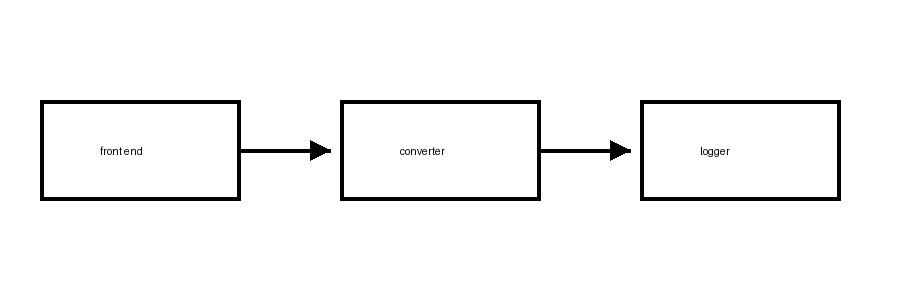

# Methods {#sec-methods}

The method has three steps. First, draw an input. Second, apply the imaginary system. Third,
estimate the input from the output.

## The model {#sec-model}

Let $\mathbb{R}$ be the real line and let $\mathcal{F}$ be a family of maps. The noise-free map
is

$$
y = f(x), \qquad f \in \mathcal{F},
$$ {#eq-map}

and the observed value is

$$
\tilde{y} = f(x) + \varepsilon, \qquad \varepsilon \sim \mathcal{N}(0, \sigma^2).
$$ {#eq-noise}

By @eq-map and @eq-noise, the estimator is the inverse of $f$ applied to $\tilde{y}$, up to
the noise.

::: {#thm-inverse}
## Invertibility

If $f$ is strictly increasing on $\mathbb{R}$, then $f$ has an inverse on its range.
:::

@thm-inverse is the only theorem in the book, and its proof is the usual one.

## Instruments {#sec-instruments}

::: {.content-visible unless-profile="nocap"}
The instrument is described in @tbl-instrument and sketched in @fig-block.

| Component | Role | Rate (kS/s) | Resolution (bits) | Noise (mV) | Notes on the imaginary build |
|:--|:--|--:|--:|--:|:--|
| Front end | Condition the signal | 1000 | 12 | 0.4 | Made up for this example |
| ADC | Digitize | 500 | 16 | 0.1 | Made up for this example |
| Logger | Store samples | 250 | 24 | 0.05 | Made up for this example |

: Components of the imaginary instrument {#tbl-instrument}
:::

The instrument is sketched in @fig-block.

{#fig-block fig-alt="Three boxes in a row labeled front end, converter and logger, joined by arrows pointing right." width=60%}
