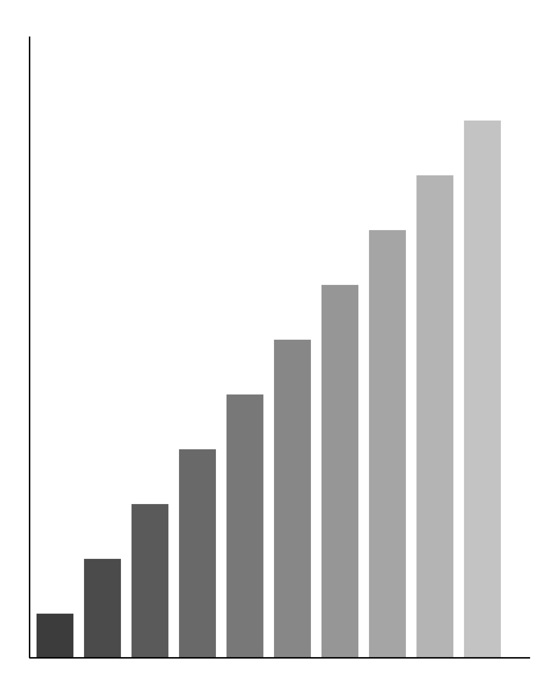

# Results {#sec-results}

The results are synthetic too. @fig-tall shows a tall plot that cannot share a page with much
else, so it takes a float page of its own.

{#fig-tall fig-alt="A staircase of gray bars rising from the lower left to the upper right, standing for estimates that grow with the input." width=95%}

## Summary

The estimates followed the inputs closely.[^2] A second display equation:

$$
\hat{x} = f^{-1}(\tilde{y}), \qquad \mathbb{E}\,\lVert \hat{x} - x \rVert^2 \le \sigma^2 .
$$ {#eq-estimator}

[^2]: Another footnote, to move the footnote counter.

```{=latex}
\begin{landscape}
```

### A landscape page {.unnumbered}

This page is turned sideways, the way a school might ask for a wide table.

```{=latex}
\end{landscape}
```

## References and the rest

The model of @eq-estimator is the one from @marsh2021. Nothing else is needed here.

::: {#refs}
:::
